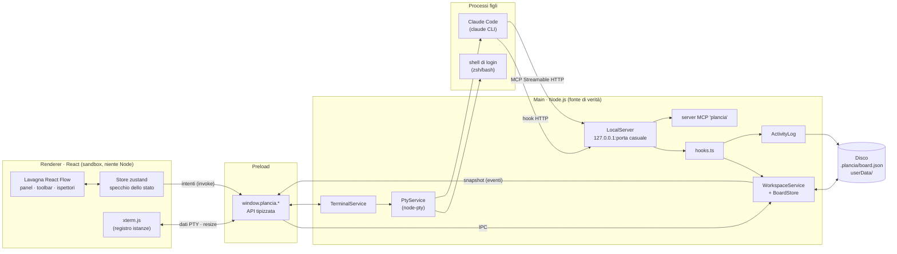
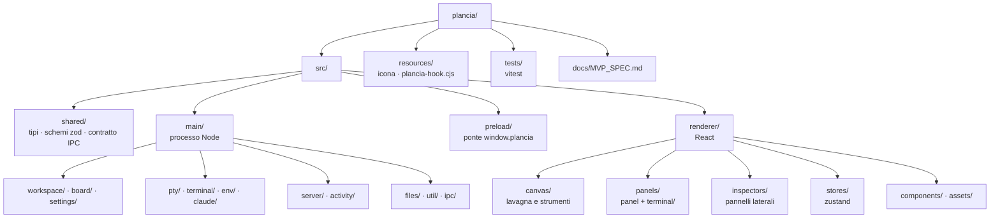
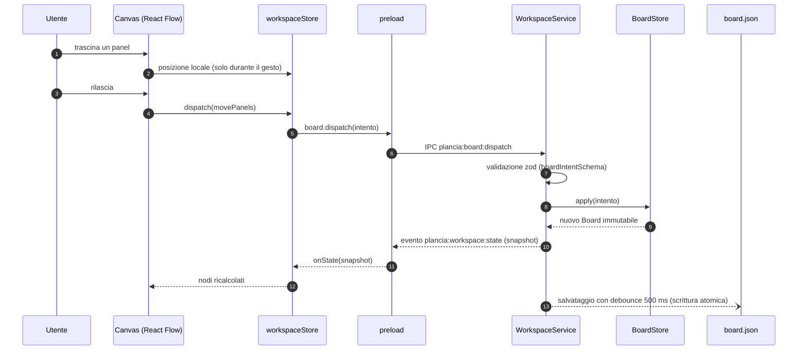
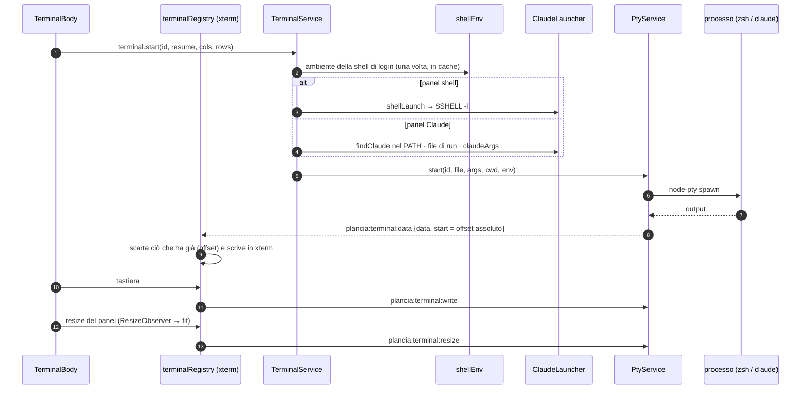
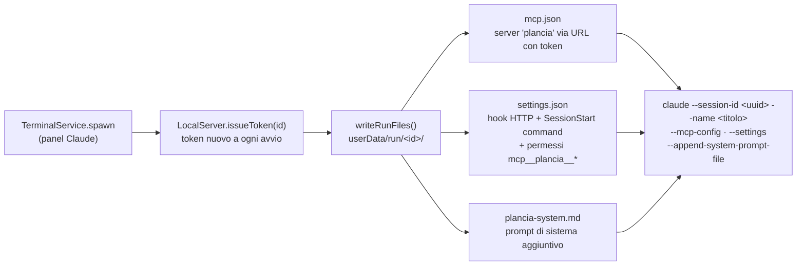
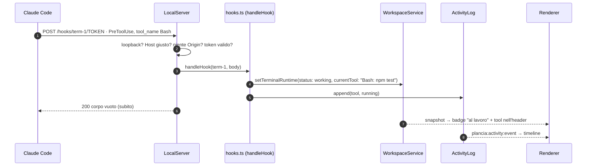
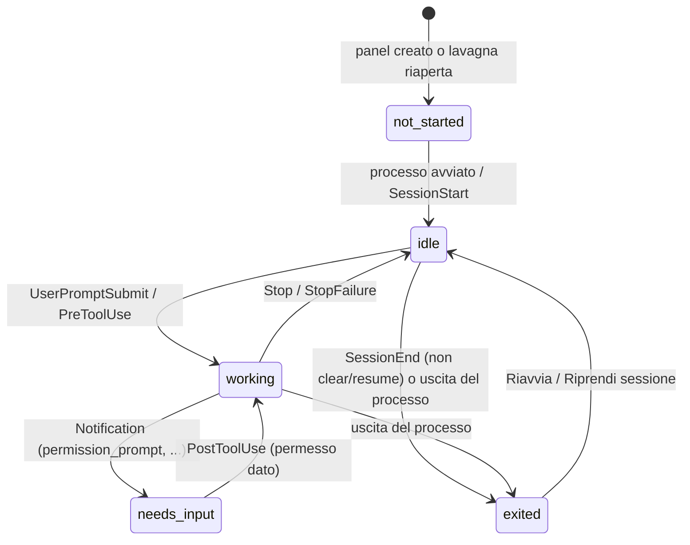
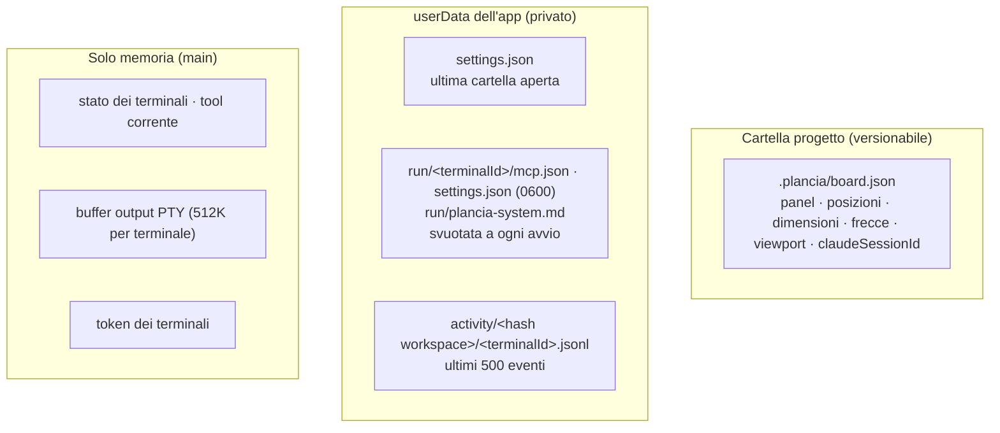
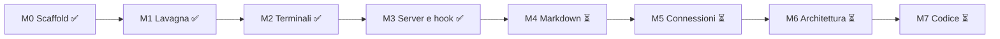

# Architettura di Plancia

> **Aggiornato a: M3** (server locale e hook) · prossima: M4 (panel Markdown)
> Questo documento viene aggiornato alla fine di ogni milestone. Specifica di prodotto: [docs/MVP_SPEC.md](docs/MVP_SPEC.md).

Plancia è un'app desktop **Electron**. Non c'è un backend remoto: il "backend" è il **processo main** (Node.js sul computer dell'utente), il "frontend" è il **renderer** (React in una finestra Chromium isolata). I due parlano solo attraverso un'API tipizzata e stretta esposta dal **preload**.

---

## 1. Visione d'insieme

**Regole che tengono in piedi tutto** (spec §3):

| Regola                                                                                   | Dove è applicata                                                                                          |
| ---------------------------------------------------------------------------------------- | --------------------------------------------------------------------------------------------------------- |
| Il main è la fonte di verità: il renderer non modifica lo stato da solo, manda _intenti_ | [BoardStore.ts](src/main/board/BoardStore.ts), [workspaceStore.ts](src/renderer/stores/workspaceStore.ts) |
| Tutto ciò che entra dall'esterno passa da zod (IPC, HTTP, file su disco)                 | [schemas.ts](src/shared/schemas.ts)                                                                       |
| Renderer isolato: `contextIsolation`, `sandbox`, niente `nodeIntegration`, CSP           | [main/index.ts](src/main/index.ts), [index.html](src/renderer/index.html)                                 |
| Server solo su `127.0.0.1`, token di 32 byte nel path, controllo Host/Origin             | [LocalServer.ts](src/main/server/LocalServer.ts)                                                          |
| Nessun percorso fuori dalla cartella progetto (traversal, symlink)                       | [resolveInWorkspace.ts](src/main/files/resolveInWorkspace.ts)                                             |
| Token e config di runtime mai nel repo                                                   | `userData/run/` — [ClaudeLauncher.ts](src/main/claude/ClaudeLauncher.ts)                                  |

---

## 2. Struttura delle cartelle

`shared/` è importato sia dal main sia dal renderer (alias `@shared`): è il **contratto** tra le due metà.

---

## 3. Flusso dei dati: intenti e snapshot

Ogni modifica alla lavagna segue lo stesso giro. Il renderer non tocca mai lo stato "vero".

Intenti disponibili (in [schemas.ts](src/shared/schemas.ts) → `boardIntentSchema`):

| Intento                                      | Effetto                                                |
| -------------------------------------------- | ------------------------------------------------------ |
| `createPanel`                                | nuovo panel (i terminali partono subito)               |
| `movePanels` · `resizePanel` · `renamePanel` | geometria e titolo                                     |
| `duplicatePanel` · `deletePanels`            | duplica / elimina (eliminare chiude anche il processo) |
| `setViewport`                                | salva pan e zoom (non rimanda lo snapshot)             |
| `setTerminalMode`                            | converte una shell in terminale Claude                 |

---

## 4. Terminali (M2)

- **Offset assoluti + buffer di 512K** nel main: quando un'istanza xterm viene (ri)creata, chiede uno _snapshot_ e poi applica solo gli eventi successivi, senza duplicati.
- **Registro fuori da React**: la stessa istanza xterm si sposta tra lavagna, modalità focus e ritorno senza perdere nulla.
- **WebGL** solo per il terminale con il focus e per quello in modalità focus; gli altri usano il DOM. Se si perde il contesto, si torna al DOM.
- **Zoom < 60%**: al posto di xterm c'è un'anteprima testuale ([TerminalPreview.tsx](src/renderer/panels/terminal/TerminalPreview.tsx)).

---

## 5. Integrazione con Claude Code (M3)

### 5.1 Avvio

Gli hook di Plancia **si sommano** a quelli dell'utente (verificato). `SessionStart` accetta solo hook `command`: per quello c'è il ponte [plancia-hook.cjs](resources/plancia-hook.cjs), eseguito con il binario di Plancia in modalità Node.

### 5.2 Eventi → stato

### 5.3 Stati del terminale

Lo stato è **solo runtime**: non finisce mai in `board.json` (vedi `toPersisted` in [BoardStore.ts](src/main/board/BoardStore.ts)).

---

## 6. Dove finiscono i dati

---

## 7. Mappa dei file per funzionalità

### 7.1 Contratto condiviso — `src/shared/`

| File                                  | Cosa contiene                                                                                                                                                                           | Usato da                   |
| ------------------------------------- | --------------------------------------------------------------------------------------------------------------------------------------------------------------------------------------- | -------------------------- |
| [types.ts](src/shared/types.ts)       | Tipi di dominio: `Panel` (terminal/markdown/architecture/code), `Board`, `Connection`, `BoardIntent`, `TerminalRuntime`, `WorkspaceSnapshot`. Derivati dagli schemi zod.                | tutto                      |
| [schemas.ts](src/shared/schemas.ts)   | Schemi zod di ogni confine: `persistedBoardSchema` (board.json), `boardIntentSchema` (intenti), payload IPC dei terminali, `hookPayloadSchema` (corpo degli hook), `appSettingsSchema`. | main (validazione), test   |
| [ipc.ts](src/shared/ipc.ts)           | Nomi dei canali IPC (`plancia:*`), tipi dei messaggi e interfaccia `PlanciaApi` = forma di `window.plancia`.                                                                            | main, preload, renderer    |
| [panels.ts](src/shared/panels.ts)     | Dimensioni predefinite e minime dei panel, titoli predefiniti.                                                                                                                          | BoardStore, renderer       |
| [activity.ts](src/shared/activity.ts) | `ActivityEvent` (voce della timeline) e stati dei tool (`running/ok/failed/cancelled`).                                                                                                 | ActivityLog, ActivityPanel |

### 7.2 Main — avvio e IPC

| File                                | Contesto                                                                                                                                                                                                                                                                                                                                                                                           |
| ----------------------------------- | -------------------------------------------------------------------------------------------------------------------------------------------------------------------------------------------------------------------------------------------------------------------------------------------------------------------------------------------------------------------------------------------------- |
| [main/index.ts](src/main/index.ts)  | **Punto d'ingresso.** Crea la finestra sicura, istanzia e collega i servizi (WorkspaceService, PtyService, TerminalService, ActivityLog, LocalServer), registra tutti gli handler IPC con validazione zod, avvia il server, ripristina l'ultima cartella, sonda `claude --version`, gestisce l'uscita pulita (chiude i processi, salva, ferma il server). In sviluppo accetta `PLANCIA_USER_DATA`. |
| [ipc/ping.ts](src/main/ipc/ping.ts) | Handler di prova della M0 (`window.plancia.ping()`).                                                                                                                                                                                                                                                                                                                                               |

### 7.3 Main — lavagna e workspace (M1)

| File                                                                    | Contesto                                                                                                                                                                                                                                                                                                                                                    |
| ----------------------------------------------------------------------- | ----------------------------------------------------------------------------------------------------------------------------------------------------------------------------------------------------------------------------------------------------------------------------------------------------------------------------------------------------------- |
| [workspace/WorkspaceService.ts](src/main/workspace/WorkspaceService.ts) | Possiede la cartella aperta: la apre (realpath + controllo), carica `board.json`, crea il `BoardStore`, salva con debounce, ricorda l'ultima cartella, riapre all'avvio. Espone `dispatch` (intenti validati), `onChange`, `onBeforeClose`, `setTerminalRuntime`, `setClaudeSessionId`. Non apre una cartella con board corrotto o di versione più recente. |
| [board/BoardStore.ts](src/main/board/BoardStore.ts)                     | **Stato della lavagna in memoria**, immutabile. Applica gli intenti (`reduce`), genera id (`term-xxxx`, `md-xxxx`…), titoli unici, limiti di dimensione. Cambi interni: stato runtime dei terminali (non salvato) e id di sessione Claude (salvato). `toPersisted`/`fromPersisted` convertono da/per il disco.                                              |
| [workspace/boardFile.ts](src/main/workspace/boardFile.ts)               | Lettura/scrittura di `.plancia/board.json`: file mancante = lavagna vuota, JSON o schema non validi = errore leggibile, versione futura = errore.                                                                                                                                                                                                           |
| [settings/AppSettings.ts](src/main/settings/AppSettings.ts)             | `userData/settings.json` (ultima cartella). Corrotto o assente = impostazioni vuote.                                                                                                                                                                                                                                                                        |
| [util/atomicWrite.ts](src/main/util/atomicWrite.ts)                     | Scrittura su file temporaneo + rename: mai file scritti a metà.                                                                                                                                                                                                                                                                                             |
| [util/debounce.ts](src/main/util/debounce.ts)                           | Task asincrono con debounce, senza sovrapposizioni, con `flush` (usato all'uscita).                                                                                                                                                                                                                                                                         |
| [files/resolveInWorkspace.ts](src/main/files/resolveInWorkspace.ts)     | Risolve un percorso dentro il progetto e rifiuta traversal e symlink che escono, anche per file non ancora creati. Oggi protegge la `cwd` dei terminali; dalla M4 ogni file dei panel.                                                                                                                                                                      |

### 7.4 Main — terminali (M2)

| File                                                                | Contesto                                                                                                                                                                                                                                                                                                                           |
| ------------------------------------------------------------------- | ---------------------------------------------------------------------------------------------------------------------------------------------------------------------------------------------------------------------------------------------------------------------------------------------------------------------------------- |
| [terminal/TerminalService.ts](src/main/terminal/TerminalService.ts) | **Collega panel e processi.** Avvia (shell o Claude, nuova sessione o `--resume`), avvia da solo i terminali appena creati, chiude il processo quando il panel viene eliminato, riavvia alla conversione shell → Claude, ferma tutto alla chiusura del workspace. Errori chiari (es. Claude non trovato con link d'installazione). |
| [pty/PtyService.ts](src/main/pty/PtyService.ts)                     | Gestione dei pseudo-terminali: output raggruppato ogni 8 ms con offset assoluti, buffer di replay (512K) che sopravvive ai riavvii, `stop` = SIGHUP poi SIGKILL, `disposeAll`. Spawn iniettabile (test con PTY finti).                                                                                                             |
| [pty/nodePtySpawn.ts](src/main/pty/nodePtySpawn.ts)                 | Adattatore verso `node-pty`.                                                                                                                                                                                                                                                                                                       |
| [env/shellEnv.ts](src/main/env/shellEnv.ts)                         | Ambiente dei terminali: legge una volta l'ambiente della shell di login (per il PATH quando l'app parte dal Finder), toglie variabili di Plancia e di un'eventuale sessione Claude Code ospite, imposta `TERM`/`COLORTERM`/`LANG`. `findExecutable` cerca nel PATH.                                                                |
| [claude/ClaudeLauncher.ts](src/main/claude/ClaudeLauncher.ts)       | Tutto ciò che riguarda **come si lancia `claude`**: argomenti (`--session-id`, `--name`, `--resume`, `--mcp-config`, `--settings`, `--append-system-prompt-file`), file di run per terminale (permessi 0600), settings con gli hook, comando del ponte SessionStart, prompt di sistema, `claude --version`, `.cmd` su Windows.     |

### 7.5 Main — server locale, hook, MCP, attività (M3)

| File                                                        | Contesto                                                                                                                                                                                                                                                                                                                       |
| ----------------------------------------------------------- | ------------------------------------------------------------------------------------------------------------------------------------------------------------------------------------------------------------------------------------------------------------------------------------------------------------------------------ |
| [server/LocalServer.ts](src/main/server/LocalServer.ts)     | Server HTTP su `127.0.0.1` (porta casuale). Rotte `/hooks/:id/:token` e `/mcp/:id/:token`. Token per terminale (32 byte, confronto a tempo costante, rotazione), rifiuta Host estranei e richieste con `Origin`, corpo max 1 MB. Agli hook risponde sempre 2xx: un errore di Plancia non blocca mai Claude.                    |
| [server/hooks.ts](src/main/server/hooks.ts)                 | **Funzione pura `handleHook`**: da evento Claude a stato del terminale, tool corrente, voci della timeline, notifica "richiede attenzione", aggiornamento dell'id di sessione dopo `/clear`. Gestisce UserPromptSubmit, Pre/PostToolUse(Failure), PermissionDenied, Notification, Stop, StopFailure, SessionStart, SessionEnd. |
| [server/toolLabel.ts](src/main/server/toolLabel.ts)         | Etichette leggibili dei tool (`Bash: npm test`, `Edit: src/auth.ts`, `plancia › list_panels`) e percorsi relativi al progetto.                                                                                                                                                                                                 |
| [server/mcp.ts](src/main/server/mcp.ts)                     | Server MCP `plancia` (uno per richiesta, stateless). Oggi: `list_panels` (lista vuota fino alla M5). Elenco dei tool pre-approvati.                                                                                                                                                                                            |
| [activity/ActivityLog.ts](src/main/activity/ActivityLog.ts) | Timeline per terminale: in memoria + JSONL su disco per workspace, ultimi 500 eventi, scritture in coda, aggiornamento dei tool per `tool_use_id`, tool non conclusi → "annullati".                                                                                                                                            |
| [resources/plancia-hook.cjs](resources/plancia-hook.cjs)    | Ponte per gli hook `command`: legge l'evento da stdin, lo manda al server, stampa la risposta. Esce sempre con 0.                                                                                                                                                                                                              |

### 7.6 Preload

| File                                     | Contesto                                                                                                                                                                                                                      |
| ---------------------------------------- | ----------------------------------------------------------------------------------------------------------------------------------------------------------------------------------------------------------------------------- |
| [preload/index.ts](src/preload/index.ts) | Espone `window.plancia` con `contextBridge`: `workspace`, `board`, `app`, `terminal`, `activity`. Solo chiamate ad alto livello, mai `ipcRenderer` grezzo. Compilato in CommonJS (`index.cjs`) perché la sandbox lo richiede. |

### 7.7 Renderer — app e lavagna

| File                                                                                               | Contesto                                                                                                                                                                              |
| -------------------------------------------------------------------------------------------------- | ------------------------------------------------------------------------------------------------------------------------------------------------------------------------------------- |
| [main.tsx](src/renderer/main.tsx) · [App.tsx](src/renderer/App.tsx)                                | Avvio React, font (Geist), stili React Flow. `App` sceglie tra schermata iniziale e lavagna, avvia gli store.                                                                         |
| [index.css](src/renderer/index.css)                                                                | **Token del design** (colori caldi, accento `#D97757`, font) e override di React Flow e xterm.                                                                                        |
| [canvas/Canvas.tsx](src/renderer/canvas/Canvas.tsx)                                                | La lavagna React Flow: nodi, griglia, minimappa, pan/zoom (rotella = pan, pinch/Ctrl = zoom), conferma prima di eliminare, monta TopBar, ToolRail, zoom, ActivityPanel, FocusOverlay. |
| [canvas/TopBar.tsx](src/renderer/canvas/TopBar.tsx)                                                | Marchio + nome cartella (clic = cambia cartella), numero di agenti, versione di Claude nel tooltip.                                                                                   |
| [canvas/ToolRail.tsx](src/renderer/canvas/ToolRail.tsx) · [tools.ts](src/renderer/canvas/tools.ts) | Barra strumenti verticale: puntatore, sposta lavagna, creazione panel, tooltip con scorciatoie.                                                                                       |
| [canvas/useShortcuts.ts](src/renderer/canvas/useShortcuts.ts)                                      | Scorciatoie a un tasto (V, H, T, L, M, A, K, Esc, 0), disattivate mentre si scrive o in modalità focus.                                                                               |
| [canvas/useCreatePanel.ts](src/renderer/canvas/useCreatePanel.ts)                                  | Crea un panel al centro della vista, a cascata.                                                                                                                                       |
| [canvas/ZoomControls.tsx](src/renderer/canvas/ZoomControls.tsx)                                    | − / percentuale / + / adatta.                                                                                                                                                         |
| [canvas/FocusOverlay.tsx](src/renderer/canvas/FocusOverlay.tsx)                                    | Modalità focus: un panel a schermo pieno al 100%. Esc esce, tranne quando si scrive in un terminale.                                                                                  |
| [components/](src/renderer/components/)                                                            | `EmptyState` (apri cartella), `ErrorToast`, `Logo`.                                                                                                                                   |

### 7.8 Renderer — panel

| File                                                                                                                                                  | Contesto                                                                                                                                                                                                                                                            |
| ----------------------------------------------------------------------------------------------------------------------------------------------------- | ------------------------------------------------------------------------------------------------------------------------------------------------------------------------------------------------------------------------------------------------------------------- |
| [panels/PanelNode.tsx](src/renderer/panels/PanelNode.tsx)                                                                                             | **Cornice comune** di ogni panel: header trascinabile (icona, titolo, tipo, stato, tool corrente, Attività, focus, menu, chiudi), ridimensionamento, menu (focus, rinomina, duplica, converti in Claude, ferma, elimina). `PanelContent` sceglie il corpo per tipo. |
| [panels/StatusBadge.tsx](src/renderer/panels/StatusBadge.tsx) · [panelMeta.ts](src/renderer/panels/panelMeta.ts)                                      | Badge di stato con colori del design; etichette; conferma di eliminazione per processi in esecuzione.                                                                                                                                                               |
| [panels/PanelIcon.tsx](src/renderer/panels/PanelIcon.tsx) · [panelIcons.ts](src/renderer/panels/panelIcons.ts)                                        | Icone Phosphor per tipo di panel.                                                                                                                                                                                                                                   |
| [panels/PanelPlaceholder.tsx](src/renderer/panels/PanelPlaceholder.tsx)                                                                               | Corpo provvisorio di Markdown, Architettura, Codice (sostituito da M4, M6, M7).                                                                                                                                                                                     |
| [panels/terminal/terminalRegistry.ts](src/renderer/panels/terminal/terminalRegistry.ts)                                                               | Istanze xterm fuori da React: replay con offset, fit e resize, link esterni, politica WebGL, ultime righe per l'anteprima.                                                                                                                                          |
| [panels/terminal/TerminalBody.tsx](src/renderer/panels/terminal/TerminalBody.tsx)                                                                     | Corpo del terminale: schermata di avvio / ripresa, errore (Claude non trovato), xterm, barra "processo terminato".                                                                                                                                                  |
| [panels/terminal/TerminalPreview.tsx](src/renderer/panels/terminal/TerminalPreview.tsx) · [xtermTheme.ts](src/renderer/panels/terminal/xtermTheme.ts) | Anteprima a zoom basso; tema e font del terminale (con fallback Nerd Font).                                                                                                                                                                                         |

### 7.9 Renderer — ispettori e store

| File                                                                      | Contesto                                                                                                       |
| ------------------------------------------------------------------------- | -------------------------------------------------------------------------------------------------------------- |
| [inspectors/ActivityPanel.tsx](src/renderer/inspectors/ActivityPanel.tsx) | Pannello laterale "Attività": timeline cronologica con icone per tipo e stato dei tool.                        |
| [stores/workspaceStore.ts](src/renderer/stores/workspaceStore.ts)         | Specchio dello snapshot del main + nodi React Flow (selezione e trascinamento solo locali). Manda gli intenti. |
| [stores/terminalStore.ts](src/renderer/stores/terminalStore.ts)           | Info app (versione Claude), errori e codici d'uscita dei terminali, avvio.                                     |
| [stores/activityStore.ts](src/renderer/stores/activityStore.ts)           | Timeline per terminale, caricata quando si apre il pannello e aggiornata dagli eventi.                         |
| [stores/uiStore.ts](src/renderer/stores/uiStore.ts)                       | Stato solo visivo: strumento attivo, panel in modalità focus, pannello Attività aperto.                        |

### 7.10 Test — `tests/`

| Area                  | File                                                                                             |
| --------------------- | ------------------------------------------------------------------------------------------------ |
| Lavagna e salvataggio | `BoardStore`, `workspace`, `debounce`                                                            |
| Terminali             | `PtyService`, `TerminalService` (con [fakePty.ts](tests/fakePty.ts)), `shellEnv`                 |
| Sicurezza percorsi    | `resolveInWorkspace`                                                                             |
| Claude / server       | `hooks`, `LocalServer` (anche MCP reale via SDK e ponte `.cjs`), `ClaudeLauncher`, `ActivityLog` |
| Contratto             | `ipc`, `ping`                                                                                    |

---

## 8. Roadmap e dove andrà il codice

| Milestone           | Nuovi pezzi previsti (spec §11)                                                                                                                                                                                                                            |
| ------------------- | ---------------------------------------------------------------------------------------------------------------------------------------------------------------------------------------------------------------------------------------------------------- |
| **M4 Markdown**     | `main/files/FileWatcher.ts` (chokidar), servizio file dei panel con versioni, `renderer/panels/markdown/` (Monaco + anteprima react-markdown)                                                                                                              |
| **M5 Connessioni**  | `shared/access.ts` + `main/access/AccessService.ts` (permessi dalle frecce), `main/claude/manifest.ts`, tool MCP `read_panel`/`write_panel`, protezione in `PreToolUse`, edge custom in `canvas/`, ispettore freccia e "Cosa vede Claude" in `inspectors/` |
| **M6 Architettura** | schema `ArchitectureDoc`, `.plancia/panels/<id>.arch.json`, `renderer/panels/architecture/` (anteprima SVG + editor in focus), layout dagre, `get_panel_schema`                                                                                            |
| **M7 Codice**       | `main/git/GitService.ts`, `renderer/panels/code/` (Monaco sola lettura + diff), feed dei file dal `PostToolUse`                                                                                                                                            |

---

## 9. Registro degli aggiornamenti

| Milestone | Cosa è cambiato in questo documento                                                                                                          |
| --------- | -------------------------------------------------------------------------------------------------------------------------------------------- |
| M3        | Prima versione: processi, flussi intenti/snapshot, terminali, integrazione Claude (hook, MCP, stati), dati su disco, mappa completa dei file |
