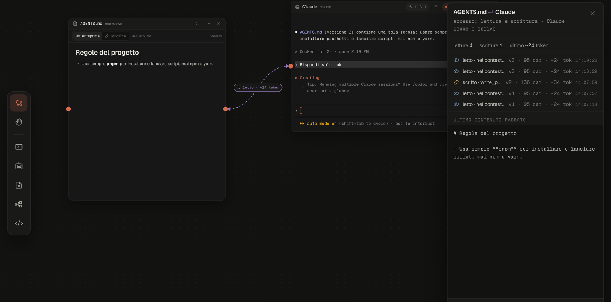
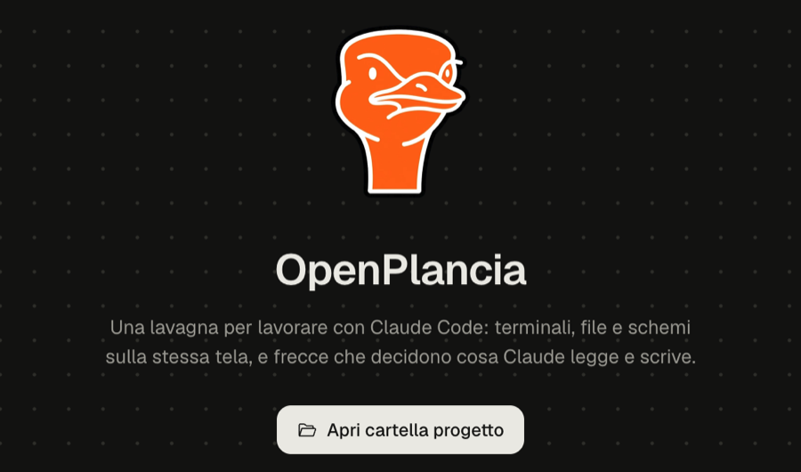
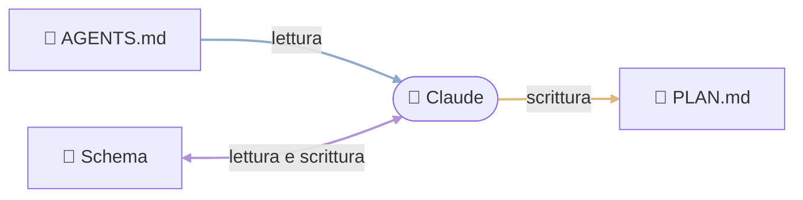
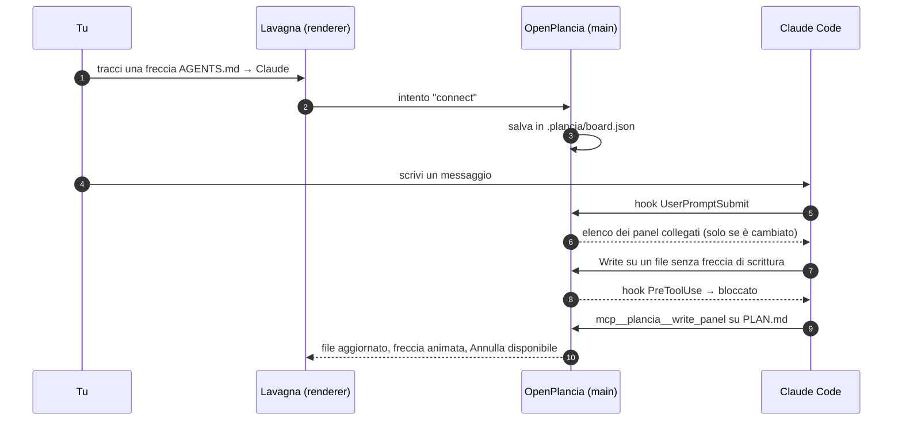

<div align="center">


# OpenPlancia

**La lavagna infinita per lavorare con Claude Code.**<br />
Terminali, file e schemi sulla stessa tela. Le frecce decidono cosa Claude legge e cosa può scrivere.

[](https://www.electronjs.org/)
[](https://react.dev/)
[](https://www.typescriptlang.org/)
[](https://nodejs.org/)
[](https://code.claude.com)
[](tests/)
[](#%EF%B8%8F-roadmap)

[Perché](#-perché) · [Funzioni](#-cosa-fa) · [Le frecce](#-le-frecce-sono-il-contesto) · [Avvio rapido](#-avvio-rapido) · [Architettura](#-architettura) · [Roadmap](#%EF%B8%8F-roadmap)

</div>

<br />

<!--
  🎬 VIDEO DEMO
  Per mostrare il video su GitHub: apri questo README in modifica sul sito,
  trascina il file .mp4 qui sotto (al posto di questo commento) e salva.
  GitHub genera un link "https://github.com/user-attachments/assets/..." che si
  riproduce direttamente nella pagina.
-->

<div align="center">



<sub>Un diagramma di architettura collegato a Claude con una freccia viola (lettura e scrittura). Claude ha provato a scrivere una relazione verso un nodo inesistente: OpenPlancia l'ha rifiutata con un errore leggibile.</sub>

</div>

---

## 💡 Perché

Con più sessioni di Claude Code aperte, il contesto finisce sparso tra tab del terminale, file aperti nell'editor e istruzioni ripetute a mano. Non si vede **cosa sa** ogni agente né **cosa può toccare**.

OpenPlancia mette tutto su una lavagna infinita: ogni terminale, ogni file e ogni schema è un panel. Per dare un file a Claude **tracci una freccia**. Per toglierlo **cancelli la freccia**. La lavagna è il contesto.

## ✨ Cosa fa

<table>
<tr>
<td width="50%" valign="top">

### 🖥️ Terminali veri sulla tela

Shell e sessioni **Claude Code** in panel spostabili e ridimensionabili (node-pty + xterm). Le sessioni Claude riprendono da dove erano dopo un riavvio (`--resume`), e una shell si converte in Claude con un clic.

</td>
<td width="50%" valign="top">

### 🧠 Stato di ogni agente a colpo d'occhio

Badge **in lavoro / attende input / fermo**, strumento in uso nell'header, contatore degli agenti attivi e un pannello **Attività** con la cronologia di ogni sessione, alimentato dagli hook di Claude Code.

</td>
</tr>
<tr>
<td valign="top">

### 📝 Markdown modificabile

Anteprima e modifica (Monaco) di file `.md` del progetto, con salvataggio, rilevamento delle modifiche esterne e gestione dei conflitti: se il file cambia mentre lo stai scrivendo, scegli tu quale versione tenere.

</td>
<td valign="top">

### 🔗 Frecce = contesto

Una freccia verso Claude gli fa **leggere** il panel; una freccia da Claude gli permette di **scriverci**. Claude riceve l'elenco dei panel collegati e vede i cambiamenti al messaggio successivo.

</td>
</tr>
<tr>
<td valign="top">

### 🛡️ Permessi che valgono davvero

Senza freccia di scrittura, `Write` ed `Edit` sui file dei panel vengono **bloccati** prima di essere eseguiti. Ogni scrittura di Claude si può **annullare** (fino a 20 passi per file).

</td>
<td valign="top">

### 🔍 Tutto trasparente

La freccia si anima quando Claude la usa. L'inspector mostra letture e scritture con versione e token stimati, e **"Cosa vede Claude"** mostra il testo esatto passato alla sessione.

</td>
</tr>
<tr>
<td colspan="2" valign="top">

### 📁 Cartelle intere in un solo panel

Scegli una cartella (es. `docs/`): il panel mostra l'albero dei suoi file `.md`, con l'anteprima del file selezionato. Una freccia sola dà a Claude il contesto di tutta la cartella, e con la freccia di scrittura può anche **creare** file nuovi (un nuovo ADR, un piano). Nessuna lavagna piena di panel Markdown.

</td>
</tr>
<tr>
<td colspan="2" valign="top">

### 📐 Schemi di architettura che Claude capisce e modifica

Disegni servizi, API, database e code con un editor a nodi; Claude li riceve come **JSON validato** e li può modificare. Se gli chiedi "aggiungi una coda tra API e worker", il diagramma si aggiorna: i nodi nuovi si posizionano da soli vicino a quelli collegati e quelli esistenti restano dove li hai messi. Un documento non valido viene rifiutato con l'errore esatto (es. `to: il nodo "fantasma" non esiste`), e **"Vedi JSON"** mostra quello che riceve Claude.

</td>
</tr>
</table>

<div align="center">

<br />
<sub>La schermata iniziale: apri una cartella di progetto o riprendi una recente. Il clic sul logo riporta sempre qui.</sub>
</div>

## 🔗 Le frecce sono il contesto



| Freccia                  | Colore   | Cosa può fare Claude                                            |
| ------------------------ | -------- | --------------------------------------------------------------- |
| panel → Claude           | 🔵 blu   | legge il contenuto, che gli arriva nel contesto                 |
| Claude → panel           | 🟠 ambra | scrive il file (con `Write`/`Edit` o con il tool `write_panel`) |
| in entrambe le direzioni | 🟣 viola | legge e scrive                                                  |
| nessuna freccia          | —        | niente: le scritture sui file dei panel vengono bloccate        |

<details>
<summary><b>Come funziona sotto il cofano</b></summary>

<br />

Ogni sessione Claude viene avviata da OpenPlancia con i propri hook e un server MCP locale. Il processo principale di Electron è l'unica fonte di verità.



- **Hook** verso un server locale su `127.0.0.1` (porta casuale, token nel percorso): `SessionStart` tramite un piccolo script ponte, `UserPromptSubmit`, `PreToolUse`, `PostToolUse`, `Notification` e `Stop` via HTTP.
- **Server MCP `plancia`** con i tool `list_panels`, `read_panel`, `write_panel` e `get_panel_schema` (JSON Schema degli schemi di architettura).
- **Niente fuori dalla cartella del progetto**: ogni percorso viene risolto e controllato prima di leggere o scrivere.

</details>

## 🪙 JSON e token: cosa si risparmia davvero

Gli schemi di architettura arrivano a Claude come JSON, non come immagini né come descrizioni a parole. Misurato su un diagramma reale di 6 nodi e 6 relazioni (token stimati come caratteri / 4):

| Come lo si potrebbe passare a Claude                                | Token circa | Note                                                       |
| ------------------------------------------------------------------- | ----------- | ---------------------------------------------------------- |
| Screenshot del diagramma (~1400×900)                                | ~1.700      | Claude deve "leggere" l'immagine; non la può modificare    |
| JSON indentato con le posizioni (com'è salvato su disco)            | ~430        | Metà dei caratteri sono spazi e coordinate                 |
| **JSON che riceve Claude** (senza posizioni, una riga per elemento) | **~220**    | Validato, id stabili, Claude lo riscrive con `write_panel` |
| Mermaid                                                             | ~90         | Più corto, ma senza schema né validazione                  |

Quindi sì, rispetto a uno screenshot si risparmia circa **8 volte** e rispetto al JSON "grezzo" circa la metà. Il JSON non è il formato più corto in assoluto: lo usiamo perché è **preciso**. Ogni scrittura di Claude viene controllata (id unici, relazioni verso nodi che esistono) e un errore non rompe mai il diagramma.

Il risparmio più grande però non dipende dal formato, ma da **quando** e **cosa** si manda:

- **Solo i panel collegati** entrano nel contesto, non l'intero progetto.
- Per una **cartella** entra l'indice dei file (percorso, titolo, versione: ~50 caratteri a file) più i file piccoli; gli altri Claude li legge solo se gli servono. Un file presente in due cartelle collegate entra una volta sola.
- Il contenuto viene mandato **all'avvio della sessione e poi solo se cambia** (la versione del panel è aumentata o le frecce sono cambiate). Se scrivi dieci messaggi senza toccare il diagramma, Claude lo riceve una volta sola.
- Oltre i 9.000 caratteri di contesto, i panel più grandi restano fuori e Claude li legge con `read_panel` solo se gli servono.

## 🚀 Avvio rapido

**Requisiti**

- macOS (l'unica piattaforma provata finora)
- [Node.js](https://nodejs.org/) 22.12 o successivo (`nvm use` legge `.nvmrc`)
- [Claude Code](https://code.claude.com) installato e con login fatto, per i terminali Claude

```bash
git clone https://github.com/Marco-Pagnanini/OpenPlancia.git
```

```bash
cd OpenPlancia && nvm use && npm install
```

```bash
npm run dev
```

Poi **Apri cartella progetto**, premi <kbd>L</kbd> per una sessione Claude, <kbd>M</kbd> per un file Markdown, e trascina una freccia dal pallino di un panel all'altro.

<details>
<summary><b>Scorciatoie da tastiera</b></summary>

<br />

| Tasto                                  | Azione                                  |
| -------------------------------------- | --------------------------------------- |
| <kbd>V</kbd>                           | puntatore                               |
| <kbd>H</kbd>                           | sposta la lavagna                       |
| <kbd>T</kbd>                           | nuovo terminale                         |
| <kbd>L</kbd>                           | nuova sessione Claude                   |
| <kbd>M</kbd>                           | nuovo file Markdown o apri un esistente |
| <kbd>F</kbd>                           | nuova cartella (albero dei file .md)    |
| <kbd>A</kbd>                           | nuovo schema di architettura            |
| <kbd>0</kbd>                           | inquadra tutti i panel                  |
| <kbd>Backspace</kbd> / <kbd>Canc</kbd> | elimina i panel o le frecce selezionati |
| <kbd>Esc</kbd>                         | torna al puntatore                      |
| doppio clic sull'header                | modalità focus sul panel                |

</details>

<details>
<summary><b>Tutti gli script</b></summary>

<br />

| Comando             | Cosa fa                                                    |
| ------------------- | ---------------------------------------------------------- |
| `npm run dev`       | avvia l'app in sviluppo (HMR sul renderer)                 |
| `npm run build`     | typecheck e build in `out/`                                |
| `npm run typecheck` | `tsc` su main, preload, shared e renderer                  |
| `npm run lint`      | ESLint                                                     |
| `npm test`          | vitest                                                     |
| `npm run dist`      | pacchetto con electron-builder in `release/` (non firmato) |

Per provare senza toccare le proprie impostazioni: `PLANCIA_USER_DATA=/percorso npm run dev` usa una cartella dati separata (ignorata nell'app pacchettizzata).

</details>

## 🧱 Architettura

| Livello             | Tecnologia                                                                   |
| ------------------- | ---------------------------------------------------------------------------- |
| App desktop         | Electron 45 · electron-vite · electron-builder                               |
| Interfaccia         | React 19 · React Flow 12 · zustand · Tailwind CSS 4 · Phosphor Icons · Geist |
| Terminali           | node-pty · xterm.js 6 (WebGL sul panel attivo)                               |
| Editor              | Monaco (caricato solo quando serve)                                          |
| Diagrammi           | React Flow dedicato in modalità focus · anteprima SVG · layout con dagre     |
| File                | chokidar per le modifiche esterne · scritture atomiche                       |
| Contratti           | TypeScript strict · zod a ogni confine (IPC, file, hook)                     |
| Integrazione Claude | hook · server MCP locale · `--session-id` / `--resume`                       |

Ogni progetto salva la sua lavagna in `.plancia/board.json`, dentro la cartella stessa: si può versionare con git o ignorare.

📐 La documentazione completa, con diagrammi e la mappa di ogni file, è in **[ARCHITECTURE.md](ARCHITECTURE.md)**. La specifica del prodotto è in [docs/MVP_SPEC.md](docs/MVP_SPEC.md).

## 🗺️ Roadmap

- [x] **M0** · Scaffold: Electron, React, TypeScript strict, test
- [x] **M1** · Lavagna infinita, panel, salvataggio in `.plancia/board.json`
- [x] **M2** · Terminali e sessioni Claude Code, ripresa dopo il riavvio, modalità focus
- [x] **M3** · Stato degli agenti tramite hook, pannello Attività
- [x] **M4** · Panel Markdown con modifica, modifiche esterne e conflitti
- [x] **M5** · Frecce come contesto: lettura, scrittura, blocco, Annulla, inspector
- [x] Schermata iniziale con cartelle recenti
- [x] **M6** · Panel Architettura: schemi in JSON validato che Claude legge e modifica, layout automatico, "Vedi JSON"
- [x] **M6.5** · Panel Cartella: albero dei `.md` di una cartella, una freccia per tutta la cartella, Claude crea e modifica file
- [ ] **M7** · Panel Codice: file e diff in sola lettura, aggiornati da quello che Claude modifica

## 🔒 Sicurezza

- Renderer isolato (`contextIsolation`, `sandbox`, niente `nodeIntegration`) con CSP restrittiva; il preload espone solo un'API tipizzata.
- Il server locale ascolta solo su `127.0.0.1`, con porta casuale e token a 32 byte; i file di avvio delle sessioni stanno nella cartella dati dell'app, mai nel progetto.
- Lettura e scrittura limitate alla cartella del progetto. Claude non scrive mai direttamente dentro `.plancia/`: gli schemi di architettura passano da `write_panel`, che li valida.
- Navigazione e nuove finestre bloccate; i link si aprono nel browser di sistema.

## ⚠️ Limiti noti

- Le modifiche ai file fatte da Claude con `Bash` non si possono intercettare in modo affidabile: il blocco vale per `Write`, `Edit`, `MultiEdit` e `NotebookEdit`.
- Con lo zoom della lavagna diverso dal 100% la selezione col mouse nei terminali può non coincidere col testo: usa la modalità focus.
- Provato solo su macOS. Il pacchetto non è firmato.
- Se `npm run dev` fallisce con `Error: Electron uninstall`, esegui `node node_modules/electron/install.js`.

---

<div align="center">
<sub>
OpenPlancia è un progetto indipendente e non è affiliato ad Anthropic.<br />
Claude e Claude Code sono marchi di Anthropic.
</sub>
</div>
