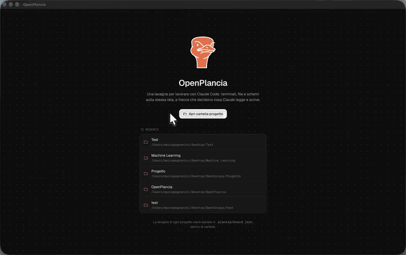

<div align="center">

[English](../../README.md) · **Italiano**


# OpenPlancia

Una lavagna infinita per lavorare con Claude Code.<br />
Terminali, file e schemi stanno sulla stessa tela, e le frecce tra loro decidono cosa Claude può leggere e scrivere.

[](https://github.com/Marco-Pagnanini/OpenPlancia/releases)
[](#scarica)
[](https://code.claude.com)

[Scarica](#scarica) · [Funzioni](#funzioni) · [Dettagli tecnici](#dettagli-tecnici) · [Sviluppi futuri](#sviluppi-futuri) · [Compilare dai sorgenti](#compilare-dai-sorgenti)

</div>

<br />

<div align="center">

<a href="../assets/openplancia-demo.mp4"></a>

<sub>La demo a velocità 8x. <a href="../assets/openplancia-demo.mp4">Guarda il video completo (3 minuti)</a>.</sub>

</div>

## Scarica

| Sistema               | File                                                                                                                                                                                                                                            |
| --------------------- | ----------------------------------------------------------------------------------------------------------------------------------------------------------------------------------------------------------------------------------------------- |
| macOS (Apple Silicon) | [OpenPlancia-0.1.1-mac-arm64.dmg](https://github.com/Marco-Pagnanini/OpenPlancia/releases/download/v0.1.1/OpenPlancia-0.1.1-mac-arm64.dmg)                                                                                                      |
| macOS (Intel)         | [OpenPlancia-0.1.1-mac-x64.dmg](https://github.com/Marco-Pagnanini/OpenPlancia/releases/download/v0.1.1/OpenPlancia-0.1.1-mac-x64.dmg)                                                                                                          |
| Windows               | [OpenPlancia-0.1.1-win-x64.exe](https://github.com/Marco-Pagnanini/OpenPlancia/releases/download/v0.1.1/OpenPlancia-0.1.1-win-x64.exe)                                                                                                          |
| Linux                 | [AppImage](https://github.com/Marco-Pagnanini/OpenPlancia/releases/download/v0.1.1/OpenPlancia-0.1.1-linux-x86_64.AppImage) · [.deb](https://github.com/Marco-Pagnanini/OpenPlancia/releases/download/v0.1.1/OpenPlancia-0.1.1-linux-amd64.deb) |

Tutte le versioni sono nella [pagina delle release](https://github.com/Marco-Pagnanini/OpenPlancia/releases). OpenPlancia avvia la tua CLI di Claude Code, quindi [Claude Code](https://code.claude.com) deve essere installato e con il login fatto.

I pacchetti non sono firmati con un certificato a pagamento, quindi il primo avvio chiede una conferma in più:

- **macOS:** apri l'app, chiudi l'avviso, poi vai in **Impostazioni di Sistema → Privacy e sicurezza** e premi **Apri comunque**.
- **Windows:** nella finestra di SmartScreen premi **Ulteriori informazioni → Esegui comunque**.
- **Linux:** `chmod +x` sull'AppImage, oppure installa il pacchetto con `sudo apt install ./OpenPlancia-*.deb`.

## Funzioni


Ogni terminale, file Markdown e schema è un panel sulla lavagna. Per dare un file a Claude tracci una freccia; per toglierglielo cancelli la freccia.

| Freccia                  | Cosa può fare Claude                                                                    |
| ------------------------ | --------------------------------------------------------------------------------------- |
| panel → Claude           | leggere il panel, che entra nel suo contesto                                            |
| Claude → panel           | scrivere il file, con `Write`/`Edit` o con il tool `write_panel`                        |
| nei due sensi            | leggere e scrivere                                                                      |
| nessuna freccia          | niente: le scritture sul file del panel vengono bloccate prima di partire               |
| Claude → un altro Claude | mandargli messaggi con `SendMessage`; con le frecce nei due sensi si scrivono a vicenda |

I panel:

- **Terminale e sessioni Claude Code.** Shell vere (node-pty e xterm.js). Le sessioni Claude riprendono dopo un riavvio con `--resume`, una alla volta o tutte insieme.
- **Markdown.** Anteprima e modifica con Monaco. Le modifiche esterne vengono rilevate, e se il file cambia mentre scrivi scegli tu quale versione tenere.
- **Cartella.** Un solo panel per un'intera cartella di file `.md`. Una freccia dà a Claude tutta la cartella, e una freccia di scrittura gli permette di creare file nuovi.
- **Architettura.** Un editor a nodi per servizi, API, database e code. Claude lo legge come JSON validato e lo può modificare; i nodi nuovi si posizionano vicino a quelli a cui sono collegati, e le modifiche non valide vengono rifiutate con l'errore esatto.
- **Codice.** I file che gli agenti stanno modificando, il più recente in alto, con il diff in sola lettura rispetto all'ultimo commit, aggiornato in tempo reale.

Intorno ai panel:

- Ogni sessione Claude mostra se sta lavorando, se aspetta un input o se è ferma, e quale strumento sta usando. Un registro delle attività conserva la cronologia.
- Una freccia si anima quando Claude la usa. L'inspector elenca ogni lettura e scrittura, e "Cosa vede Claude" mostra il testo esatto passato alla sessione.
- Ogni scrittura di Claude su un panel si può annullare, fino a 20 passi per file.

## Dettagli tecnici

| Livello     | Tecnologie                                              |
| ----------- | ------------------------------------------------------- |
| App desktop | Electron 45, electron-vite, electron-builder            |
| Interfaccia | React 19, React Flow 12, zustand, Tailwind CSS 4        |
| Terminali   | node-pty, xterm.js 6 (WebGL sul panel attivo)           |
| Editor      | Monaco, caricato solo quando serve                      |
| Contratti   | TypeScript strict, zod a ogni confine (IPC, file, hook) |
| Claude Code | hook, un server MCP locale, `--session-id` / `--resume` |

**Come Claude riceve il contesto.** OpenPlancia avvia ogni sessione Claude con i propri hook e un server MCP locale chiamato `plancia`. Gli hook (`SessionStart`, `UserPromptSubmit`, `PreToolUse`, `PostToolUse`, `Notification`, `Stop`) parlano con un server su `127.0.0.1` con porta casuale e un token di 32 byte. `UserPromptSubmit` manda l'elenco dei panel collegati, `PreToolUse` blocca le scritture senza freccia, e il server MCP espone `list_panels`, `read_panel`, `write_panel` e `get_panel_schema`.

**Il contesto resta piccolo.** Vengono mandati solo i panel collegati, e solo quando cambiano: all'avvio della sessione, poi di nuovo quando cambia la versione di un panel o cambiano le frecce. Una cartella arriva come indice dei suoi file più quelli piccoli; gli altri Claude li legge con `read_panel` quando gli servono. Uno schema di architettura arriva come JSON compatto senza posizioni, circa 220 token per 6 nodi e 6 relazioni, contro circa 1.700 per uno screenshot dello stesso schema.

**Salvataggio.** Ogni progetto tiene la sua lavagna in `.plancia/board.json`, dentro la cartella del progetto, così si può versionare con il codice o ignorare.

**Sicurezza.** Il renderer gira con `contextIsolation`, `sandbox` e una CSP restrittiva, e il preload espone solo un'API tipizzata. Ogni percorso viene risolto e controllato rispetto alla cartella del progetto prima di leggere o scrivere. Claude non scrive mai direttamente dentro `.plancia/`: gli schemi passano da `write_panel`, che li valida.

L'architettura completa, con diagrammi e la mappa di ogni file, è in [ARCHITECTURE.md](../../ARCHITECTURE.md).

## Sviluppi futuri

**Template riutilizzabili.** Salvare una lavagna come template, con i suoi panel, le frecce e le sessioni Claude, e partire da lì per un nuovo progetto. Per esempio un planner, un implementatore e un revisore già collegati a un `PLAN.md` condiviso, pronti da usare in qualsiasi repository.

In programma anche:

- Pacchetti macOS firmati e notarizzati, così il primo avvio non chiede passaggi in più.
- Prove a mano su Windows e Linux. I pacchetti li costruisce la CI, ma finora l'app è stata provata a mano solo su macOS.

## Compilare dai sorgenti

Servono [Node.js](https://nodejs.org/) 22.12 o successivo e [Claude Code](https://code.claude.com) installato e con il login fatto.

```bash
git clone https://github.com/Marco-Pagnanini/OpenPlancia.git
```

```bash
cd OpenPlancia && nvm use && npm install
```

```bash
npm run dev
```

Apri una cartella di progetto, premi <kbd>L</kbd> per una sessione Claude e <kbd>M</kbd> per un file Markdown, poi trascina una freccia dal pallino di un panel all'altro.

<details>
<summary><b>Scorciatoie da tastiera</b></summary>

<br />

| Tasto                                  | Azione                                   |
| -------------------------------------- | ---------------------------------------- |
| <kbd>V</kbd>                           | puntatore                                |
| <kbd>H</kbd>                           | sposta la lavagna                        |
| <kbd>T</kbd>                           | nuovo terminale                          |
| <kbd>L</kbd>                           | nuova sessione Claude                    |
| <kbd>M</kbd>                           | nuovo file Markdown, o apri un esistente |
| <kbd>F</kbd>                           | nuovo panel Cartella                     |
| <kbd>A</kbd>                           | nuovo schema di architettura             |
| <kbd>K</kbd>                           | nuovo panel Codice                       |
| <kbd>0</kbd>                           | inquadra tutti i panel                   |
| <kbd>Backspace</kbd> / <kbd>Canc</kbd> | elimina i panel o le frecce selezionati  |
| <kbd>Esc</kbd>                         | torna al puntatore                       |
| doppio clic sull'header di un panel    | modalità focus                           |

</details>

<details>
<summary><b>Script</b></summary>

<br />

| Comando              | Cosa fa                                    |
| -------------------- | ------------------------------------------ |
| `npm run dev`        | avvia l'app in sviluppo (HMR sul renderer) |
| `npm run build`      | typecheck e build in `out/`                |
| `npm run typecheck`  | `tsc` su main, preload, shared e renderer  |
| `npm run lint`       | ESLint                                     |
| `npm test`           | vitest                                     |
| `npm run dist:mac`   | `.dmg` per Apple Silicon e Intel           |
| `npm run dist:win`   | installer `.exe` (NSIS), da Windows        |
| `npm run dist:linux` | AppImage e `.deb`, da Linux                |

Ogni sistema si costruisce sul proprio, perché `node-pty` è un modulo nativo. Il push di un tag `v*` avvia [release.yml](../../.github/workflows/release.yml), che costruisce tutti e tre e li allega a una release in bozza.

Per provare l'app senza toccare le tue impostazioni: `PLANCIA_USER_DATA=/un/percorso npm run dev`.

</details>

## Limiti noti

- Le modifiche ai file che Claude fa con `Bash` non si possono intercettare in modo affidabile. Il blocco e il panel Codice valgono per `Write`, `Edit`, `MultiEdit` e `NotebookEdit`.
- Con lo zoom della lavagna diverso dal 100%, la selezione col mouse nei terminali può non coincidere col testo. Usa la modalità focus.
- Se `npm run dev` fallisce con `Error: Electron uninstall`, esegui `node node_modules/electron/install.js`.

---

<div align="center">
<sub>
OpenPlancia è un progetto indipendente e non è affiliato ad Anthropic.<br />
Claude e Claude Code sono marchi di Anthropic.
</sub>
</div>
